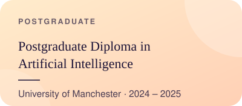
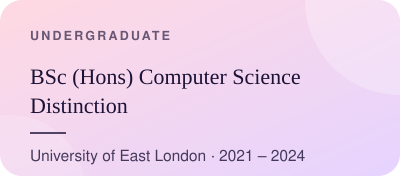
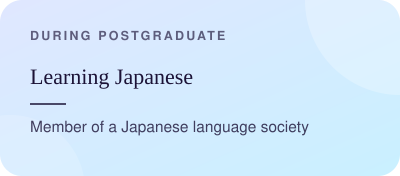
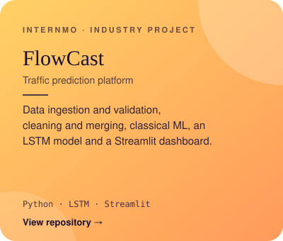
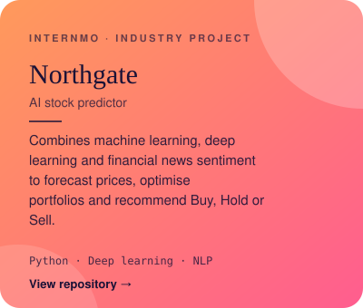
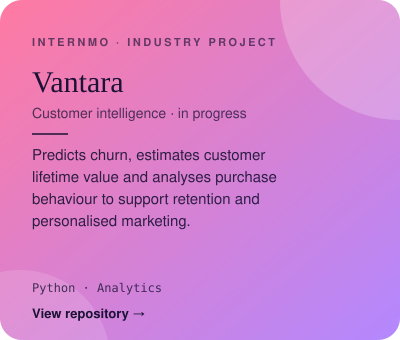
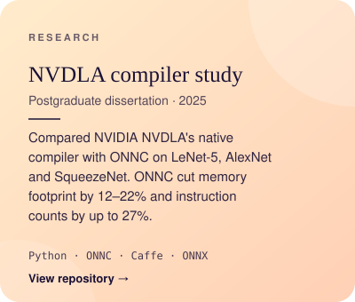
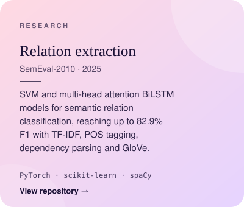
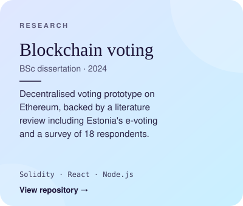

  

 

  
  

 

  
  

 

| | |
|:--|:--|
| **Languages** | Python · Java · C / C++ · Bash · Solidity |
| **Machine Learning** | PyTorch · scikit-learn · NumPy · Pandas · LSTM and attention models · time-series forecasting · NLP (spaCy, Gensim) · sentiment analysis |
| **Web & APIs** | REST APIs · Node.js · Express · React · Streamlit |
| **Systems & Tools** | Git · Docker · Linux · Wireshark |
| **Databases** | MySQL · MongoDB |
| **Foundations** | Data structures & algorithms · Software testing · SDLC · Agile |

 

<b>INDUSTRY PROJECTS · INTERNMO</b>

  
  
  

 

<b>RESEARCH &amp; DISSERTATIONS</b>

  
  
  

 

| | |
|:--|:--|
| Sep 2026 – Present | **AI Engineering Intern**, Internmo Building three industry-level AI projects: FlowCast, Northgate and Vantara. |
| Apr – May 2025 | **Micro-Intern**, University of Manchester Three-week consultancy project with an industry client in a multidisciplinary team; presented findings to stakeholders and delivered a report with recommendations. |
| Feb 2023 – Feb 2024 | **Systems & Network Administrator Assistant**, University of East London Monitored system health and troubleshot networks across university IT infrastructure; deployed software on Linux and Windows, documented incidents for audits, and provided first-line support and onboarding. |
| Sep – Dec 2022 | **Mentee**, Microsoft Embrace Mentoring Programme Career-readiness programme; built a personal development plan from technical strengths and skill gaps. |

 

  
   
  Open to opportunities.
    
  
  
  
  
    
  samarth841sharma@gmail.com

